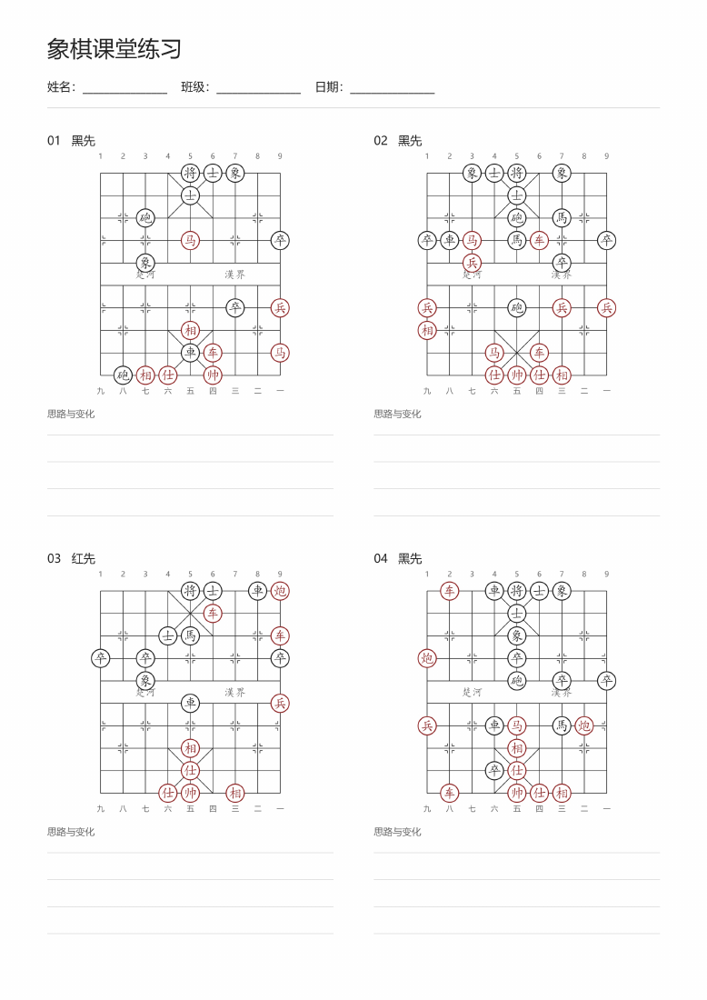

# 象备课

面向中国象棋老师的备课助手。从棋库里选择适合本次教学的棋例，预览和调整后，导出棋谱、PPT 课件或学生讲义。

[在线使用](https://awzmrc6liek6.meoo.pub/) · [使用说明](docs/使用说明.md) · [更新记录](CHANGELOG.md)

## 为什么做象备课

准备一堂象棋课，需要找棋例、核对局面、安排难度，再把内容整理成能上课使用的材料。象备课把选题、预览和导出接在一起，让老师可以在同一个地方完成这些操作。

AI 用来理解备课要求和调整意图，棋例来自已有棋库。老师可以查看实际局面、手动增删选题，再决定导出哪些内容。

## 目前能做什么

- **三种备课方式**：根据学生档案备课、直接说明课程要求，或浏览棋库自行选题。
- **连续调整**：继续提出“太难了”“换一批”“改成45分钟”“多给两道”等要求，调整当前这次备课。
- **棋盘预览**：查看局面和已有着法，支持步进、自动播放和翻转。
- **课件导出**：支持 PGN、CBL、PPTX，可逐题选择题目或棋谱形式。PPTX 使用静态棋图。
- **学生讲义**：可附带 A4 PDF，每页四张棋图，每题四行书写区，与课件一起打包下载。
- **本地记录**：保存学生档案、备课历史和实际导出记录，供后续备课参考。

当前可用内置棋例 **170 条**：开局 10、中局 30、残局 10、杀法 120。数量核对日期：2026 年 11 月 13 日。

访客可以浏览棋库；AI 备课、选题、档案和导出需登录。账号支持邮箱注册、密码登录和验证码重置密码。学生档案与备课记录保存在当前浏览器，按账号分开保存，不自动跨设备同步；清除本站数据会丢失这些本地记录。

## 看一次备课怎么完成

进入“直接生成棋例”，输入“2道3步杀”，预览选出的棋例，按需要手动调整，最后选择课件格式并导出。完整操作见[使用说明](docs/使用说明.md)。

下面是实际导出的一页学生讲义：

## 开发中做过的取舍

- [AI 理解要求后，为什么还需要选题规则](docs/AI与选题规则.md)
- [为什么修改课时需要保留整次备课的上下文](docs/多轮备课调整.md)
- [课件导出如何适配老师已有的工具](docs/课件与讲义.md)

## 仓库内容

这里公开产品介绍、使用说明、实际界面、讲义样张和开发记录。应用源码及完整题库保留在私有开发仓库。

使用中遇到问题，可以通过本仓库的 [Issues](https://github.com/Usernamethatavailable/XiangBeiKe-showcase/issues) 反馈。请写明操作步骤、预期结果和实际结果；截图请遮住学生信息和账号信息。
