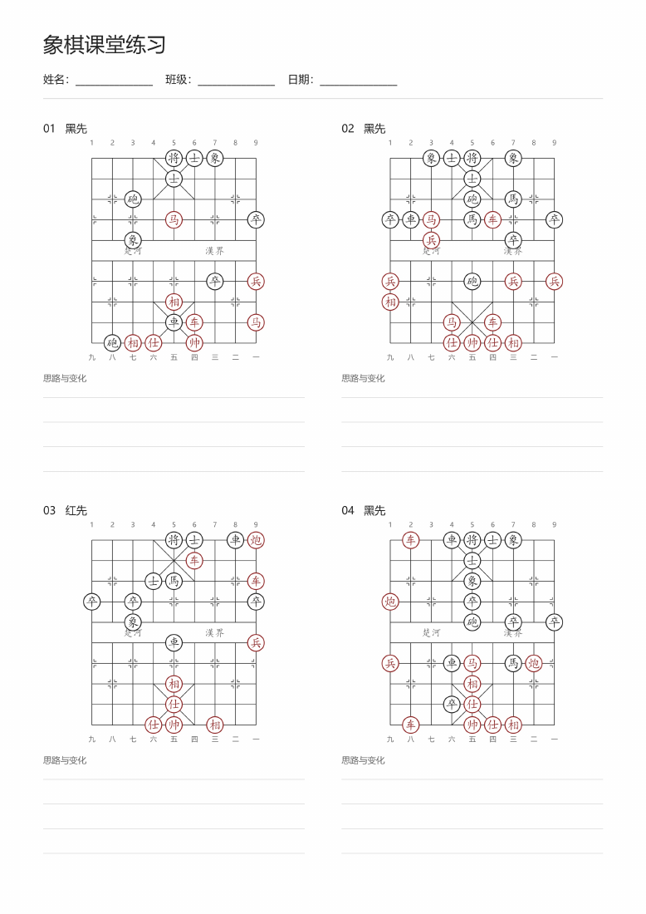

# 象备课使用说明

[打开象备课](https://awzmrc6liek6.meoo.pub/)。当前主要面向电脑浏览器备课。

## 选择备课方式

首页提供三个入口：

- **根据学生档案备课**：使用学生的基础、优势、短板和近期重点作为本次备课的参考。
- **直接生成棋例**：不建立档案，直接说明想要的内容、数量、课时或学生水平。
- **浏览棋库并自行选题**：自行查看和选择棋例，不调用 AI。

未登录时可浏览棋库；选题、AI、档案和导出需要登录。点击“登录 / 注册”可通过邮箱注册账号，之后使用密码登录；忘记密码可通过邮箱验证码重置。

## 直接生成和继续调整

可以先输入“2道3步杀”。明确的数量和杀法步数会作为选题条件；若对应棋例不足，会按规则补选。

也可以说明学生水平和课时，再连续调整。例如，项目已有的演示验证使用过这组输入：

1. “一小时课程，业3学生”
2. “太难了”
3. “稍微难一点点”
4. “换一批”
5. “改成45分钟”
6. “多给两道”

这是一组操作演示，不是学生课堂案例。每次补充都在当前备课上继续调整。普通调整替换本轮选题；明确加题则保留原题并追加。

切换学生、切换备课方式或开始新备课时，会隔离上一轮课程的上下文。

## 查看和手动选题

棋库分为开局、中局、残局、杀法。点击棋例名称，在右侧棋盘查看；使用勾选框选择或取消棋例。预览和选中是两个独立操作。

棋盘可以逐步查看已有着法、自动播放或翻转。老师可以在 AI 选题后继续手动增删，再确认导出内容。

## 导出课件和讲义

选好棋例后，点击“导出课件”：

1. 选择 **PGN/CBL** 或 **PPTX**。PGN/CBL 选项中，单个棋例导出为 PGN，多个棋例导出为 CBL。
2. 逐项选择题目或棋谱形式。题目形式去掉着法，适合留给学生思考；棋谱形式保留已有着法。
3. 如需纸面练习，勾选“附带学生讲义（PDF）”。
4. 点击“确认导出”。附带讲义时下载 ZIP，解压后得到课件和 PDF；否则直接下载课件。

PPTX 中的棋盘是静态图片。学生讲义为 A4 竖版，每页四张初始棋图，每题四行书写区，标出红先或黑先，不包含答案；最后一页不会用重复棋图补满。

## 档案与历史放在哪里

学生档案和备课历史保存在当前浏览器，登录后按账号隔离。注册账号不会把这些资料自动同步到另一台设备；清除本站数据会丢失本地记录。

档案可使用学生代号。使用档案推荐时，所选档案中的教学描述会发送给 AI 处理，请只填写本次教学需要的信息。
