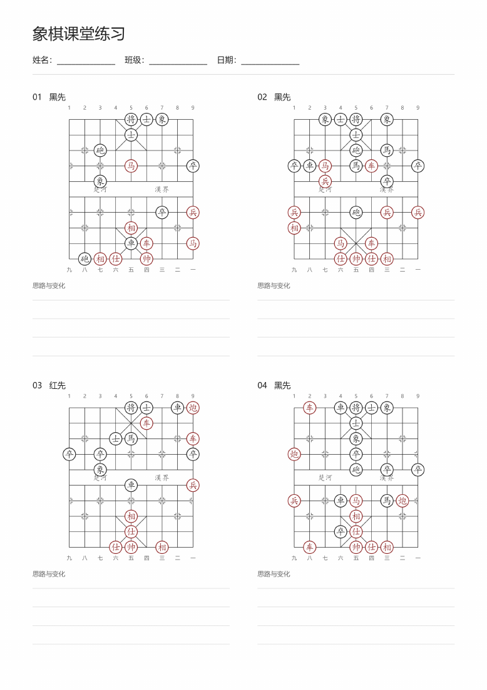

# 课件导出如何适配老师已有的工具

在网页里选出棋例，只完成了备课的一部分。老师还需要把它放进棋谱软件、投屏课件或纸面练习中，文件能否正确打开、中文能否正常显示，直接影响材料是否可用。

象备课目前提供 PGN、CBL、PPTX，并可附带学生讲义 PDF。

## 棋谱文件保留已有使用方式

PGN/CBL 选项会在单个棋例时生成 PGN，多个棋例时生成 CBL。项目为中文棋谱使用 GBK 编码和 CRLF 换行，并核对标题、局面及已有着法。

题目和棋谱形式服务于不同的教学环节：题目形式去掉着法，方便学生先思考；棋谱形式保留已有着法，方便老师接着讲解。两者都基于相同棋例，可以逐项选择。

## PPT 使用静态棋图

网页棋盘先渲染为图片，再放入 PPTX。这样可以减少演示软件重新解释中文棋子文字位置造成的显示差异。

相应代价是 PPT 内的棋盘不能前后走子。需要逐步预览已有着法时，可以使用网页棋盘；当前产品没有把互动棋盘嵌入 PPT。

## 讲义服务于纸面练习

学生讲义使用固定的 A4 竖版，每页四张初始局面，每题四行书写区，标出红先或黑先，不包含答案、题目标题或标签。超过四题时继续分页，末页不重复补题。

讲义是导出时的可选项。未勾选时仍只下载原课件；勾选后才把原课件与 PDF 一起打包为 ZIP。

固定排版使打印结果容易检查，也减少老师逐页整理的工作，但不能替代老师自己的教案和讲解设计。当前实现聚焦于棋图和书写区，没有加入自动教学讲解。
